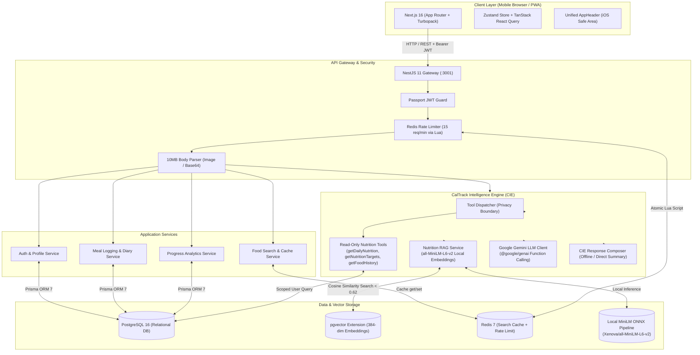
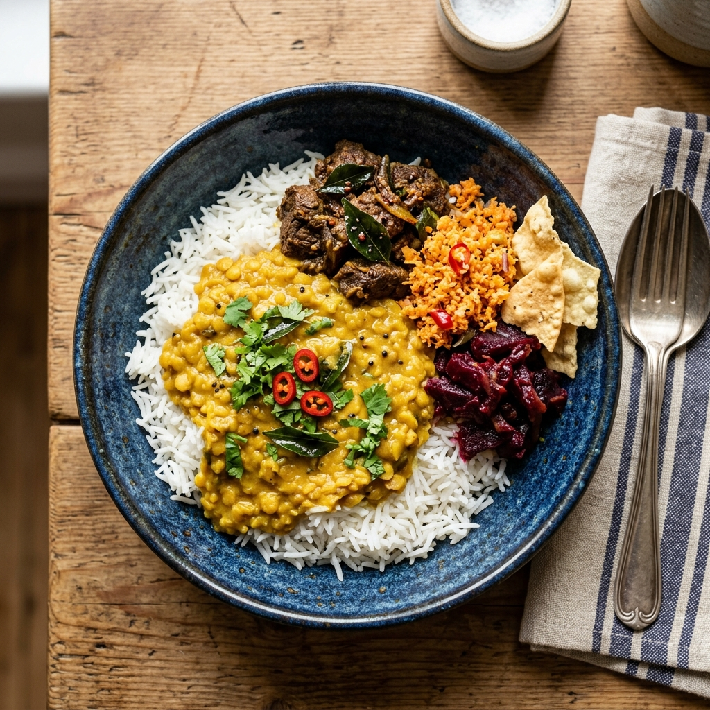
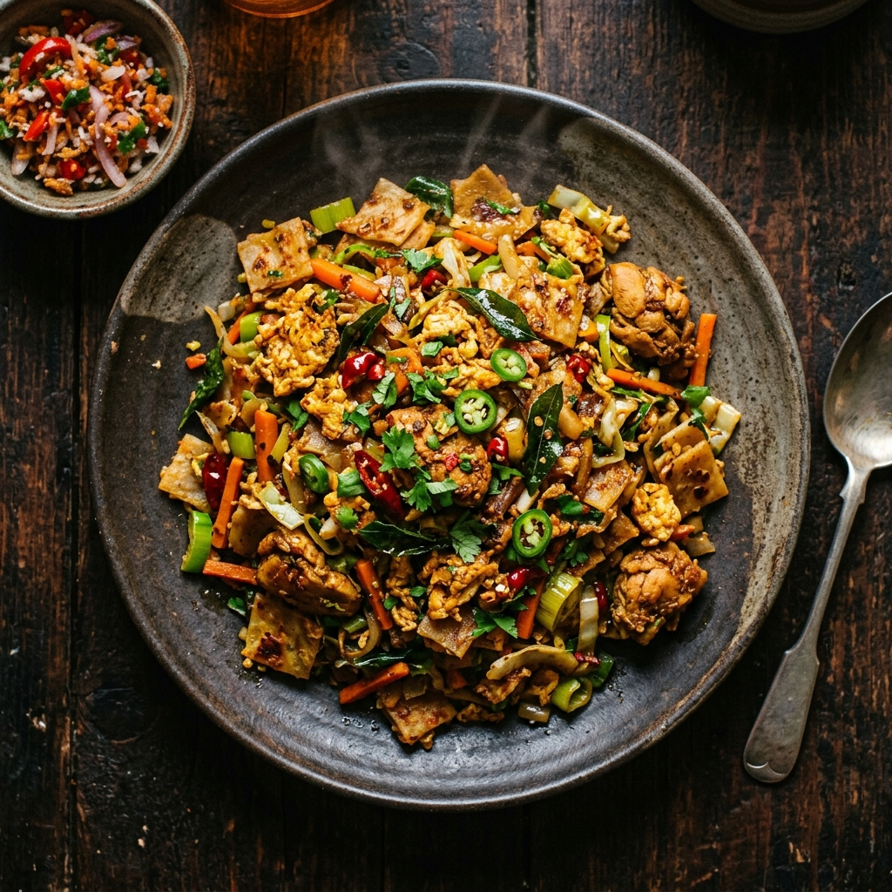

# CalTrack 🇱🇰

> **Mobile-first nutrition and calorie intelligence tailored for Sri Lankan diets, backed by localized food logging, personalized metabolic targets, progress analytics, and the CalTrack Intelligence Engine (CIE).**

[](https://github.com/MohamedIlzam/CalTrack/actions/workflows/ci.yml)
[](https://nodejs.org/)
[](https://nextjs.org/)
[](https://nestjs.com/)
[](https://github.com/pgvector/pgvector)
[](https://www.typescriptlang.org/)

---

## 📖 Overview

Standard calorie counters struggle with South Asian food culture: curries have varying coconut milk bases, staple portions are measured in "plates" or "hoppers" rather than ounces, and nutritional requirements for South Asian populations follow distinct clinical body-composition risk profiles.

**CalTrack** is built specifically to solve this gap. It combines a verified database of Sri Lankan cuisine (with Sinhala, Tamil, and English aliases), an intuitive mobile food diary, evidence-based nutrition targets adhering to WHO South Asian BMI criteria, transparent adherence analytics, and a privacy-conscious AI Intelligence Engine.

---

## ✨ Implemented Core Features

### 1. 🍛 Localized Sri Lankan Food Database & Smart Search
- **Authentic Dishes & Portions:** Nutritional data for staples (*Kottu*, *String Hoppers*, *Pol Roti*, *Parippu / Dhal*, *Ambul Thiyal*, *Kiri Bath*, *Watalappan*, etc.) indexed with culturally accurate portion units (plates, cups, pieces, grams).
- **Trilingual Aliases:** Instant search indexing across English, Sinhala (e.g., `ආප්ප`, `කොත්තු`), and Tamil (e.g., `ஆப்பம்`, `கொத்து`).
- **Sub-50ms Cached Search:** Food queries are cached in Redis with graceful fallback directly to PostgreSQL if the cache is unreachable.

### 2. 📅 Interactive Food Diary & Dynamic Plate Builder
- **Slot Logging:** Four daily meal slots (*Breakfast*, *Lunch*, *Dinner*, *Snacks*).
- **Plate Builder:** Dynamic portion scaling, ingredient accumulation, and immediate live macro calculation (Calories, Protein, Carbs, Fat).
- **Persistent State:** Dual-tier state persistence utilizing client-side Zustand storage with authoritative PostgreSQL database re-synchronization on refresh.

### 3. 🎯 Profile & Evidence-Based Target Calculation
- **Mifflin-St Jeor Energy Expenditure:** Calculates Basal Metabolic Rate (BMR) and Total Daily Energy Expenditure (TDEE) based on age, gender, height, weight, and activity multipliers.
- **South Asian BMI Standard:** Strictly adheres to WHO expert consultation thresholds for Asian populations:
  - *Underweight:* $< 18.5$
  - *Normal:* $18.5 - 22.9$
  - *Overweight:* $23.0 - 27.4$
  - *Obese:* $\ge 27.5$
- **Customizable Targets:** Automatic or manual macro ratios with dynamic calorie-to-gram balancing.

### 4. 📊 Progress Analytics & Honest Adherence Insights
- **Adherence Tracking:** 7-day and 30-day views tracking actual calorie and protein intake against target budgets.
- **Honest Empty States:** Unlogged days are excluded from denominators to prevent misleading zero-averages.
- **Macro Distribution:** Consumed energy breakdown visualizer (% Protein, % Carbs, % Fat).
- **Weight History:** SVG line tracking showing weight trends and net weight progression over time.

### 5. 🧠 CalTrack Intelligence Engine (CIE)
- **Authenticated Read-Only Tools:** Secure tool foundation allowing AI to inspect the current user's daily nutrition, targets, and historical adherence without exposing raw database queries or allowing mutation.
- **Strict User Isolation:** All tool invocations require an authenticated JWT and bind queries directly to `req.user.userId`.
- **Zero-External-Dependency Nutrition RAG:** Local semantic search powered by `@xenova/transformers` (`all-MiniLM-L6-v2`, 384-dimensional ONNX embeddings) and PostgreSQL `pgvector`, retrieving peer-reviewed nutrition science for sports nutrition, protein requirements, energy balance, and hydration.

### 6. 📱 Unified Mobile-First UX
- **Safe-Area Navigation:** Header content adapts dynamically to iOS safe-area insets (`env(safe-area-inset-top)`), clearing both the iPhone camera notch (~47px) and Dynamic Island (~59px).
- **Unified Header:** Consistent navigation bar across Home, Search, AI Coach, and Progress with single-click profile navigation and complete session logout.

---

## 🏗️ System Architecture



---

## 🛠️ Technology Stack

| Layer | Technologies | Purpose |
|---|---|---|
| **Frontend** | Next.js 16.2 (App Router), React 19, TypeScript | Mobile-first SPA, Turbopack bundling, server components |
| **State & Data Fetching** | Zustand 5, TanStack React Query 5 | Client-side persistent cache, asynchronous query invalidation |
| **Styling & Motion** | Tailwind CSS v4, Motion 12 | Fluid styling, responsive mobile frame, iOS safe-area handling |
| **Backend Framework** | NestJS 11, Express, Node.js 22 | Modular backend architecture, dependency injection, REST API |
| **Database & ORM** | PostgreSQL 16, Prisma ORM 7 (`@prisma/adapter-pg`) | Relational persistence, declarative schema, database migrations |
| **Vector Search** | `pgvector` extension (384 dimensions) | Cosine similarity semantic search over food & nutrition chunks |
| **Local AI Embeddings** | `@xenova/transformers` (`all-MiniLM-L6-v2`) | In-process ONNX neural embeddings, zero third-party API latency |
| **Caching & Rate Limiting** | Redis 7, `ioredis` | Sub-50ms search cache, atomic Lua token-bucket rate limiting |
| **External LLM** | Google GenAI SDK (`@google/genai`) | Natural language function selection and nutrition consultation |
| **Authentication** | Passport.js, JWT, Bcrypt | Stateless bearer authentication, password hashing |
| **Testing & CI** | Jest, Supertest, GitHub Actions | 27 test suites, 180+ tests, automated PR validation pipeline |

---

## 🔬 CalTrack Intelligence Engine (CIE) Deep Dive

The CIE is architected with strict enterprise privacy and safety boundaries:

```
[User Question] 
      │
      ▼
[Rate Limiter (Redis 15 req/min)]
      │
      ▼
[Intent Analysis & Tool Dispatcher]
      ├── Tool 1: getDailyNutrition(date)
      │     └── Returns consumed calories, macros, and items for the specified date
      ├── Tool 2: getNutritionTargets()
      │     └── Returns user goals, calorie targets, macro budgets, and current weight
      └── Tool 3: getFoodHistory(days)
            └── Returns multi-day adherence trends, averages, and logged food entries
      │
      ▼
[Privacy Boundary]
      └── Tool execution is strictly bound to req.user.userId. Real user database 
          records are never exposed to unpaid third-party LLMs without strict sanitation.
      │
      ▼
[Nutrition RAG (pgvector + all-MiniLM-L6-v2)]
      └── Retrieves verified nutrition science chunks (ISSN position stands, WHO 
          guidelines) matching query cosine distance (< 0.62 threshold).
      │
      ▼
[Context-Aware Synthesized Response]
```

### Curated Nutrition RAG Knowledge Base
The local RAG layer indexes verifiable, peer-reviewed clinical nutrition literature across:
- **Protein Synthesis & Hypertrophy:** Optimal distribution ($1.6 - 2.2\,\text{g/kg}$ per day, ISSN position stands).
- **Energy Balance & Calorie Density:** Deficit targets for sustainable fat loss ($300 - 500\,\text{kcal/day}$).
- **Macronutrient Functions:** Roles of carbohydrates in glycogen replenishment and dietary fats in hormonal health.
- **Hydration & Electrolytes:** Baseline hydration guidelines ($30 - 35\,\text{mL/kg/day}$).
- **Meal Planning & Adherence:** Sustainable habit formation and dietary variety.

---

## 🚦 Implementation & Verification Status

To ensure complete transparency for evaluators and developers, here is the current verification status of all components:

| Component | Status | Notes |
|---|---|---|
| **Sri Lankan Food Database** | ✅ Production Verified | Seeded with authentic foods, multilingual aliases, and standard units |
| **Diary Logging & Meal Plate** | ✅ Production Verified | Tested against race conditions, refresh loss, and multi-slot updates |
| **Profile & South Asian BMI** | ✅ Production Verified | Tested against WHO clinical cutoffs and Mifflin-St Jeor formulas |
| **Progress Analytics Dashboard** | ✅ Production Verified | Verified across 7-day and 30-day aggregations with honest zero-handling |
| **Unified Header & Safe Area** | ✅ Production Verified | Verified on desktop, Android, and iOS Notch / Dynamic Island devices |
| **CIE Read-Only Nutrition Tools** | ✅ Production Verified | Unit tested with 100% parameter validation and user isolation |
| **CIE Function Calling Foundation**| ✅ Verified (Synthetic) | Validated via synthetic fixtures and mock tool dispatching |
| **Nutrition RAG Semantic Retrieval**| ✅ Production Verified | Local MiniLM ONNX embedding + pgvector cosine similarity verified |
| **Offline Response Fallback** | ✅ Production Verified | Provides structured nutrition summaries when LLM is unavailable |
| **Live Gemini API Live Stream** | ⚠️ Limited / Fallback | Google Gemini API free-tier keys experience quota / availability constraints; CIE gracefully falls back to deterministic summaries |

---

## 📸 Visual Assets & Interface Preview

CalTrack features authentic Sri Lankan culinary assets and mobile-first ergonomics:

| Welcome & Onboarding | Authentic Sri Lankan Cuisine |
|:---:|:---:|
|  |  |
| **Hero & Nutrition Overview** | **Traditional Staples (Hoppers)** |
|  |  |

---

## 🚀 Local Development Setup

### Prerequisites
- [Node.js](https://nodejs.org/) (v20 or v22 recommended, matching Node 22 in CI)
- [Docker & Docker Compose](https://www.docker.com/)
- Git

### 1. Clone Repository
```bash
git clone https://github.com/MohamedIlzam/CalTrack.git
cd CalTrack
```

### 2. Start PostgreSQL with `pgvector` and Redis
```bash
docker-compose up -d
```
This boots:
- PostgreSQL 16 on port `5433` (mapped from container `5432` to avoid collisions with any local PostgreSQL instance) with the `pgvector` extension pre-loaded.
- Redis 7 Alpine on port `6379`.

### 3. Backend Setup & Configuration
```bash
cd backend

# Copy environment configuration
cp .env.example .env

# Install backend dependencies
npm install

# Generate Prisma client and apply database schema
npx prisma generate
npx prisma db push

# Apply Nutrition RAG table schema
npm run migrate:nutrition-rag

# Seed initial food database and RAG knowledge vectors
npx prisma db seed
npm run seed:nutrition-rag

# Start NestJS development server
npm run start:dev
```
The backend will be running at `http://localhost:3001`.

### 4. Frontend Setup & Configuration
```bash
cd ../frontend

# Copy environment configuration
cp .env.example .env.local

# Install frontend dependencies
npm install

# Start Next.js development server
npm run dev
```
Open [http://localhost:3000](http://localhost:3000) in your browser (or mobile device via local network IP).

---

## 🧪 Testing & Quality Assurance

CalTrack maintains comprehensive end-to-end and regression test coverage across both frontend and backend:

### Backend Test Suite (NestJS & Jest)
```bash
cd backend
npm test
```
- **17 Test Suites / 177 Unit Tests Passed:**
  - `nutrition-rag.service.spec.ts`: RAG embedding generation, distance filtering, deduplication
  - `tool-dispatcher.service.spec.ts`: Parameter validation, authorization, and error handling
  - `gemini-function-calling.service.spec.ts`: Function declaration schema compliance
  - `cie-coach.service.spec.ts`: Multi-turn context resolution and fallback handling
  - `food.service.spec.ts`: Redis caching, vector search fallback, and multilingual query matching
  - `meal-regression.spec.ts` & `meal-preview-http.spec.ts`: Logging integrity and macro calculations
  - `progress.service.spec.ts`: Adherence formulas and date boundary constraints
  - `redis.service.spec.ts`: Fixed-window rate limiting Lua script execution

### Frontend Test Suite (Next.js & Node)
```bash
cd frontend
npm test
```
- **10 Verification Suites Passed:**
  - AI chat safe markdown formatting & HTML injection defense
  - Diary state synchronization and multi-meal entry persistence
  - Meal card calorie and macro rendering accuracy
  - Date normalization and time-zone boundary resilience
  - Search error recovery and debounce behavior
  - Profile authentication guard and session logout cleanup
  - Mifflin-St Jeor target calculation and South Asian BMI categorization
  - Progress analytics calculations (averages across logged days only)
  - Unified `AppHeader` rendering, initials fallback, and iOS safe-area layout

---

## ⚙️ GitHub Actions CI Pipeline

CalTrack runs an automated continuous integration pipeline on all pull requests and branch pushes via `.github/workflows/ci.yml`:

- **Strict Dependency Installation:** Uses `npm ci` with cached npm stores.
- **Dual Matrix Execution:**
  - `backend`: Prisma client generation, TypeScript type-check (`tsconfig.build.json`), Jest unit test execution with synthetic fixtures, and `nest build`.
  - `frontend`: TypeScript type-check (`tsc --noEmit`), automated regression tests, and `next build` static page generation.
- **Zero Third-Party Dependency in CI:** All tests run with synthetic mocks; no external Gemini API calls or production database connections are required.

---

## 🌐 Deployment Readiness & Cloud Architecture

### Infrastructure Requirements for Free Tier Deployment
1. **Backend RAM:** Minimum 350MB, recommended 512MB RAM (to host Node.js + in-process `@xenova/transformers` ONNX model weights). Compatible with Render Free Web Service, Railway, or Fly.io (512MB instance).
2. **Database:** PostgreSQL 16 with `pgvector` enabled (available on Supabase Free Tier or Neon Serverless Postgres).
3. **Redis:** Redis 7 with Lua scripting support (available on Upstash Redis Free Tier, providing 10,000 commands/day over standard TLS connections).
4. **Environment Configuration:**
   - Backend: `DATABASE_URL`, `REDIS_URL`, `JWT_SECRET`, `GEMINI_API_KEY`, `PORT`
   - Frontend: `NEXT_PUBLIC_API_URL` (points to deployed backend domain)

---

## 📄 License & Attribution

Developed with ❤️ for the Sri Lankan health and fitness community.  
Authored by [Mohamed Ilzam](https://github.com/MohamedIlzam).
